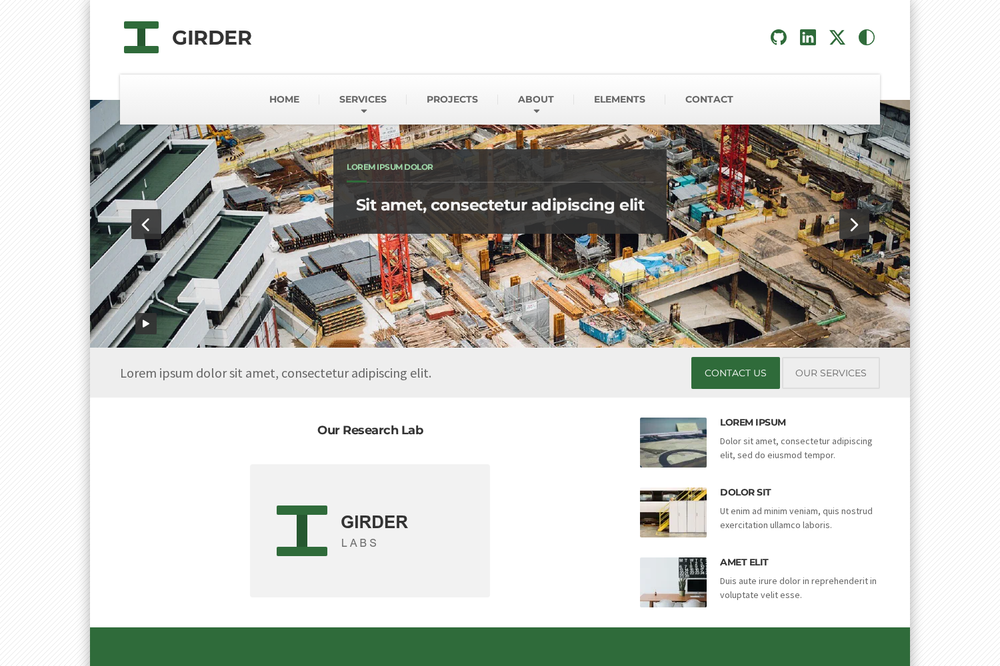

# Girder

A boxed, corporate [Hugo](https://gohugo.io/) theme for company sites: a hero carousel, three-level dropdown navigation, service pages with photos, a photo gallery and a contact page with a map.

**Demo:** <https://hubertbanas.github.io/hugo-theme-girder/> (all placeholder text, CC0 photos)



## Features

- Boxed layout on a patterned background, with a title band and breadcrumbs on every page
- Hero carousel: pauses on hover and focus, has a pause button, and doesn't move for visitors who prefer reduced motion
- Navigation three levels deep, with dropdowns on desktop and a MENU button on phones
- Page layouts: text beside a photo, quick-facts and link lists, figures, section listings, a photo gallery with a lightbox, and a contact page with an OpenStreetMap map
- Responsive WebP images in several sizes, made by Hugo from your originals
- Dark mode: follows the visitor's device, with a header button to pick automatic, light or dark (remembered, applied before the page is drawn)
- Colours for both schemes set in your site config; your own styles in one file
- Self-hosted fonts and scripts: pages load nothing from other hosts (except the map's tiles)
- Works under a sub-path, such as a GitHub Pages project site
- No jQuery, no Bootstrap, no npm needed to build: Hugo and Dart Sass only
- Accessibility built in: skip link, visible focus, labelled controls, underlined links in text

## Requirements

- Hugo **extended** 0.146.0 or later (tested with 0.170.1)
- [Dart Sass](https://gohugo.io/functions/css/sass/#dart-sass) 1.79 or later on the `PATH` (Hugo's own Docker image includes it)

## Quick start

As a git submodule:

```bash
git submodule add https://github.com/hubertbanas/hugo-theme-girder.git themes/hugo-theme-girder
echo 'theme = "hugo-theme-girder"' >> hugo.toml
```

Or as a [Hugo Module](https://gohugo.io/hugo-modules/) (needs Go):

```bash
hugo mod init github.com/you/your-site
```

```toml
[module]
  [[module.imports]]
    path = "github.com/hubertbanas/hugo-theme-girder"
```

Then copy [`exampleSite/hugo.toml`](exampleSite/hugo.toml) as a starting point: it shows every setting, with comments. Use `pageRef` (not `url`) for menu entries to your own pages, so the links work under a sub-path.

## Site settings

All under `[params]` in your `hugo.toml`, all optional.

| Setting                             | What it does                                                                                                                                                                                           |
| ----------------------------------- | ------------------------------------------------------------------------------------------------------------------------------------------------------------------------------------------------------ |
| `description`                       | The pages' default meta description                                                                                                                                                                    |
| `logo`, `logo_width`, `logo_height` | Logo, a file under `assets/`. An SVG needs both width and height; a photo or PNG only its width                                                                                                        |
| `show_title`                        | Show the site title beside the logo (always shown when there's no logo)                                                                                                                                |
| `favicon`, `apple_touch_icon`       | Icon files under `static/`                                                                                                                                                                             |
| `copyright`                         | Footer text, Markdown; `{year}` becomes the current year                                                                                                                                               |
| `hero_width`, `hero_height`         | The shape every hero photo is cropped to (default 1920 x 580)                                                                                                                                          |
| `[[params.social]]`                 | Header links: `name`, `url`, and `icon` (`x`, `linkedin`, `facebook`, `github`, `instagram`, `youtube`; default: the name)                                                                             |
| `[params.colors]`                   | `primary`, `primary_dark`, `link`, `text`, `muted`, `background`, `surface`, `dark` (what each colours: see the demo's config)                                                                         |
| `[params.colors_dark]`              | The same keys for the dark scheme                                                                                                                                                                      |
| `dark_mode`, `dark_mode_toggle`     | Dark mode (default on) and its header button (default shown); `false` turns either off                                                                                                                 |
| `logo_dark`                         | A logo for the dark scheme (optional)                                                                                                                                                                  |
| `[params.contact]`                  | Contact page: `heading`, `title`, `address` (lines), `phones` (`label`, `number`, `icon` `phone` or `fax`), `email`, `hours` (lines)                                                                   |
| `[params.map]`                      | Contact page map: `lat`, `lng`, `zoom`, `title`, `label`; optional `tiles`, `attribution`, `pin` (marker image under `assets/`), `snapshot` (picture of the map under `assets/`, shown until it loads) |

Menus: `main` is the navigation (up to three levels, with `parent`), `footer` the links in the footer.

## Page front matter

**Home page** (`content/_index.md`), all optional; see [the demo's](exampleSite/content/_index.md):

- `slides`: the hero carousel, each `image` (under `assets/`), `kicker`, `heading`, `link`, `alt`; plus `slides_interval` (ms) and `slides_label`
- `tagline` and `buttons` (`label`, `link`, `style` `primary` or `default`): the band under the hero
- `featured` (`heading`, `image`, `image_dark` for the dark scheme, `link`, `alt`) and `cards` (`title`, `text`, `image`, `link`)
- `banner`: a line of text in a band of the primary colour
- `logos`: a grid of logos (`image`, `name`, `link`, `width`, `height`)

**Pages and sections**, all optional:

- `image`: a photo beside the text; with `intro` (Markdown), the intro sits beside the photo and the content follows below
- `facts` (Markdown lines, under `facts_heading`) and `links` (`title`, `link`, under `links_heading`)
- `figures`: images (`src`, `alt`) in two columns below the text
- `logo_image`, `logo_link`, `logo_in_column`: a logo above the text
- `justify`: `paragraphs` or `paragraphs-and-lists`
- `list_pages: true` on a section: list its pages at the end

**Layouts**: `layout: gallery` on a page bundle shows its photos (captions from `resources` titles; see [Projects](exampleSite/content/projects/index.md)); `layout: contact` shows the map and contact details.

Links in front matter and in Markdown may be page paths (`/services/`, `../history.md`): the theme turns them into the right URLs.

## Customising

- **Colours:** `[params.colors]` and `[params.colors_dark]`. Check the contrast of your own colours in both schemes: text and links at least 4.5:1 on their background, white text on `primary` too.
- **Your own CSS:** create `assets/scss/_custom.scss` in your site. It's loaded last, and `@use 'variables' as *;` gives you the theme's colours (CSS custom properties, so they follow the scheme) and fonts, and `@include dark { … }` inside a rule styles it for the dark scheme only.
- **Templates:** copy any file from the theme's `layouts/` into your site's `layouts/` at the same path and change it there.

## Working on the theme

The demo site in `exampleSite/` uses the theme from the repo itself. With [Docker](https://docs.docker.com/get-docker/) and its Compose plugin, nothing else is needed:

```bash
./site.sh start     # preview at http://localhost:1313, live reload
./site.sh stop
./site.sh build     # production build into exampleSite/public/
./site.sh check     # what CI runs (needs Node 22+): format, lint, spelling, private terms, build, build check
```

Another port: `PORT=1314 ./site.sh start`, or `PORT=1314` in a `.env` file. Without Docker, with Hugo extended and Dart Sass installed: `hugo server --source exampleSite --themesDir ../..` from the repo root (the clone's folder must be called `hugo-theme-girder`).

The build check (`npm run check:build`) builds under a sub-path (`https://example.org/hugo-theme-girder/` by default) and fails on any link, image, script or stylesheet that would break there.

### Keeping private data out

This repo is public. Two checks keep private details (names, addresses, internal hosts) out of it, using a denylist that is never committed:

- `~/.config/hugo-theme-girder/private-terms.txt`: one term per line, case-insensitive, whole words; `re:` lines are regular expressions.
- `git config core.hooksPath .githooks` enables the pre-commit hook, which blocks secret-looking files and any staged file with a private term.
- `npm run check:private` scans every file; `npm run check:publish` scans the whole git history, the commit identities and (with gitleaks) secrets. Run it before every push that makes history public.
- CI runs the same scan with the denylist from the repository secret `PRIVATE_TERMS`.

## Publishing the demo

A push to `main` builds `exampleSite/` and publishes it to GitHub Pages (`.github/workflows/ci.yml`). One-time setup on GitHub:

1. **Settings → Pages → Build and deployment → Source: GitHub Actions.**
2. **Settings → Secrets and variables → Actions → New repository secret:** `PRIVATE_TERMS`, the denylist's text.
3. Optionally, install the [Renovate app](https://github.com/apps/renovate) for dependency updates (`.github/renovate.json5`).

## Credits and license

The theme is under the [MIT License](LICENSE). The vendored libraries, fonts and demo photos keep their own licenses, listed in [CREDITS.md](CREDITS.md).
